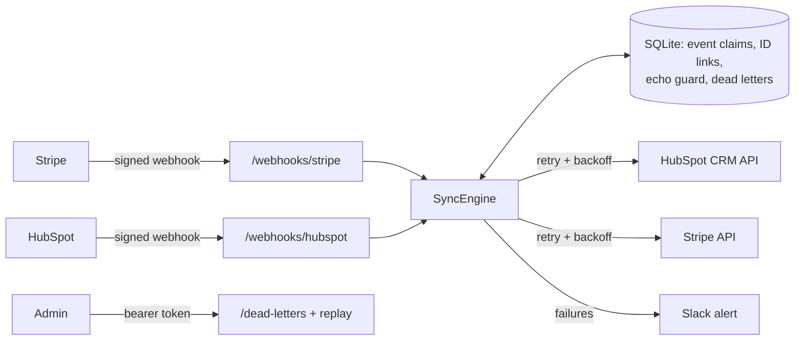

# HubSpot ↔ Stripe two-way sync

A production-style integration that keeps HubSpot contacts and Stripe customers in sync, in both directions. Sales sees billing status, MRR and lifetime value in the CRM, and corrections made in HubSpot flow back to Stripe.

It is built for the cases that break most no-code syncs: duplicate webhook deliveries, events arriving out of order, infinite update loops, API rate limits, and silent failures.

```
[3] Customer starts a $49/month plan, billed for 3 seats
    -> subscription_synced: status=active, MRR=$147.00
[6] Stripe fires customer.updated for the change WE just made (classic infinite-loop trap)
    -> echo_suppressed: loop prevented, nothing written back
[7] HubSpot API rate-limits us twice (429, then 503) during a payment sync
    -> payment_synced after automatic retries: lifetime value=$294.00
[9] HubSpot rejects a write permanently (e.g. a property was deleted by an admin)
    -> dead_lettered; alert sent: "Sync failed: stripe customer.subscription.updated (dead letter #1)"
[10] Admin fixes the property and replays the dead letter
    -> replay -> subscription_synced; status in HubSpot: past_due
```
*(Output of `uv run python demo.py`. That script runs the full scenario through the real HTTP endpoints, with HubSpot and Stripe faked.)*

## What it does

| Direction | Trigger | Result |
|---|---|---|
| Stripe → HubSpot | `customer.created` / `customer.updated` | Contact created or updated, matched by link or email (no duplicates) |
| Stripe → HubSpot | `customer.subscription.*` | `stripe_subscription_status`, `stripe_mrr` (normalised across intervals and seats) |
| Stripe → HubSpot | `invoice.paid` | `stripe_lifetime_value`, `stripe_last_payment_date` |
| HubSpot → Stripe | `contact.propertyChange` (email, phone, first/last name) | Stripe customer updated |
| Both | first sync | Stripe customer gets `metadata.hubspot_contact_id` so support can jump to the CRM record |

## Reliability built in

| Problem | How it's handled |
|---|---|
| Forged or replayed webhooks | Stripe signatures and HubSpot v3 signatures are verified with constant-time comparison and timestamp tolerance. The HubSpot URL is rebuilt from `PUBLIC_BASE_URL`, so the check works behind proxies. |
| Duplicate deliveries | Every event ID is claimed in SQLite before processing. Re-deliveries are skipped, and failed events stay replayable. |
| Infinite loops (A updates B, B's webhook updates A…) | An echo guard records each value the sync writes and suppresses the matching webhook that comes back. |
| Events arriving out of order | A subscription or invoice for an unknown customer fetches the customer and creates the contact first. |
| Rate limits and outages | 429, 5xx and network errors are retried with exponential backoff and jitter, and `Retry-After` is honoured. |
| Permanent failures | The event goes to a dead-letter queue, a Slack alert is sent, and `POST /dead-letters/{id}/replay` replays it after the fix. |
| Drift over time | `reconcile` compares every linked pair. `--fix` repairs drift, with Stripe as the source of truth. |
| Slow webhook responses | Handlers acknowledge immediately and process in the background. |

## Architecture



```
src/hs_stripe_sync/
  app.py          FastAPI endpoints (webhooks, health, dead-letter admin)
  sync.py         SyncEngine: idempotency, echo guard, ordering, retries, dead letters
  mapping.py      Pure Stripe <-> HubSpot field mapping (MRR normalisation, names, currencies)
  signatures.py   Stripe + HubSpot v3 webhook verification
  hubspot.py      HubSpot CRM v3 client + one-time custom property setup
  stripe_api.py   Stripe REST client
  store.py        SQLite state
  retry.py        Backoff policy; http_errors.py maps HTTP status to retryable vs permanent
  cli.py          serve | setup-hubspot | reconcile [--fix]
```

## Run it

```bash
uv sync
uv run python demo.py      # 10-step narrated scenario, no accounts needed
uv run pytest -q           # 43 tests: signatures, mapping, engine, HTTP clients, endpoints
```

## Deploy against real accounts

1. **HubSpot:** create a private app with the scopes `crm.objects.contacts.read`, `crm.objects.contacts.write` and `crm.schemas.contacts.write`. Subscribe its webhooks to `contact.propertyChange` for `email`, `phone`, `firstname` and `lastname`, pointing at `https://<your-host>/webhooks/hubspot`.
2. **Stripe:** add a webhook endpoint at `https://<your-host>/webhooks/stripe` for these events:
   - `customer.created`, `customer.updated`
   - `customer.subscription.created`, `customer.subscription.updated`, `customer.subscription.deleted`
   - `invoice.paid`

   Use a restricted API key with Customers read/write.
3. Copy `.env.example` to `.env` and fill it in.
4. Run `uv run python -m hs_stripe_sync.cli setup-hubspot` once. It creates the "Stripe (synced)" property group and its properties, and is safe to re-run.
5. Run `uv run python -m hs_stripe_sync.cli serve` on any host with HTTPS (Render, Fly.io, Railway or a VPS).
6. Optionally, schedule `reconcile --fix` to run nightly.

## Design notes and limits
- **Single process.** Background tasks run in the web process and SQLite holds state. That's right for small and mid-size accounts (thousands of events a day). For higher volume, swap in a real queue (SQS, Redis) and Postgres; `SyncEngine` doesn't change.
- **Lifetime value** uses read-modify-write per paid invoice. The nightly `reconcile` is the backstop for rare concurrent-invoice races.
- **Field mapping lives in one pure module** (`mapping.py`), so client-specific fields are a small, tested change.

---
Built by Zarif Latif. I build HubSpot integrations and automations white-label for agencies: fixed scope, fixed price, with a written spec, tests and a Loom handover. zarif@postlaunch.agency
